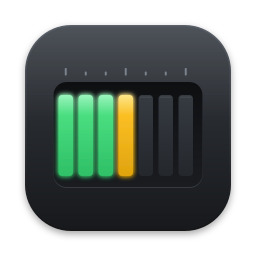

# AgentRM

A resource manager for coding agents on macOS (and Linux): Activity Monitor for the agentic era.

When several Claude Code, Codex or other agent sessions share one laptop, each starts clusters,
builds, simulators and dev servers as if it had the machine to itself, asks you to paste API keys
into the chat, and leaves things running when it is done. Nobody stops them, memory runs out, and
everything slows to a crawl. AgentRM puts one rule in front of that: **ask first, say why, and
clean up after yourself.**

New installs start in **dry run**: AgentRM asks and reports but never pauses or stops anything
until you have seen its decisions and turned auto-stop on.

## What it does

### Memory: leases, not luck

- **Heavy work asks first.** A kind cluster, `docker compose up`, a Docker, cargo, Gradle or Xcode
  build, a simulator or emulator, a VM, a local model, a load test, a dev server or a headless
  browser gets a lease before it starts. It is granted only if the memory is really there (what
  macOS can hand out now, less what is already promised, less a margin) and the Mac is not
  thrashing.
- **A queue, not a refusal.** A request that does not fit waits its turn and is granted the moment
  it fits; `agentrm acquire --wait` returns then, so an agent waits without polling. Meanwhile
  AgentRM reclaims from whoever uses theirs least, never from work in active use.
- **Holders are asked, not just pressed.** A holder can say what giving its lease up would cost it
  now (`agentrm yield`); answers are checked against what happens next, and a session that
  misreports is believed less.
- **Measured, not declared.** An agent may say how much it needs (`--mem`); what its builds really
  start is measured as they run, including work done inside Docker's VM and Gradle's daemons. A
  session that goes well over what it asked for is told at once and charged AgentRM's estimate
  for an hour.

### Evidence, not trust

Who is asking comes from the process tree, not from what an agent says. Every command an agent
runs is parsed and matched to what it touches (kube contexts, containers, ports, simulators). A
claim on something already running needs recorded use. Leases stay alive on use, not on any
activity of the session, and each agent's whole process tree is measured, so a wrapper script
whose name says nothing is still counted.

### Ask, pause, stop, restore

Anything running with no lease is asked about, then **paused** (nothing is lost; using it resumes
it), then **stopped**: containers stopped, not removed; simulators shut down; processes stopped
with their whole tree. Everything stopped is listed and can be restored with `agentrm restore`.
VMs, apps and things you started are only ever asked about.

### Cleaning up after agents

- **What an ended session left.** When an agent exits, its leases are released at once, and what
  it started (including processes that detached, found by the session markers in their
  environment) is collected on a fast, reversible path. The Collected tab lists each ended
  session with what it left and what happened to it.
- **Finished tasks.** A lease belongs to the branch it was taken on: when a pull request is opened
  from it or the session moves to another branch, the holder is asked, and an unused lease is
  released.
- **Leaks.** A dev process whose memory keeps climbing for an hour (a stuck language server, a
  leaking dev server) is flagged, and you can restart or stop it in one click.

### Learning from use

- **Receipts.** When a lease ends, a line goes to `~/.agentrm/receipts/<project>.txt`: what was
  asked, what the work really used, and what to ask next time. Agents read it before asking.
- **Estimates** follow what each kind of work really used in each project.
- **Room made ahead.** AgentRM learns which heavy work tends to follow which, and when the next
  request would not fit, pauses idle, unclaimed things before it arrives, once its predictions
  have proved right.
- **When to stop.** How long to wait before stopping something is learned per kind, from how long
  things sat idle before they were used again.

### A vault for accounts

Agents keep needing accounts: a GitHub token to open a PR, an API key to call a model, AWS to
deploy. Instead of a long-lived secret pasted into a chat or an `.env`, **an agent asks for an
account and says why; you approve with Touch ID; it gets access that expires by itself.** The
secret stays in your Keychain.

```sh
agentrm vault run openai --purpose "run the eval suite" -- python eval.py
```

| Kind | What the agent gets |
|---|---|
| **API key** | A token for AgentRM's local proxy, which adds the real key to each request. **The agent never holds the key.** About 60 APIs (OpenAI, Anthropic, Gemini, Stripe…) are filled in for you |
| **GitHub App** | A fresh installation token limited to the repos and permissions asked, revoked at GitHub when the grant ends |
| **AWS** | A short STS session for one role |
| **Login** | A username and password, for staging dashboards and test accounts |

A session asking again for no more than it was given gets it without asking you, until the grant
expires (30 minutes by default). Live and ended grants, with why they ended, are in the Vault tab.
See [the vault](docs/vault.md).

### You stay in charge

- **Auto-stop is earned.** Every pause and stop decision, taken or (in dry run) not, is kept for
  you to mark right or wrong. Auto-stop is turned on level by level (what ended sessions left,
  then unclaimed things, then idle leases) once each level's record is good, and a stop you mark
  wrong turns its level off again.
- **Your click, not the agent's.** Pinning, settings and overriding an agent from a terminal need
  a click in the app. Only you can let everything through for a while (`agentrm bypass`); an
  agent cannot.
- **Tampering is reported**: a killed daemon, edited files, removed hooks.
- **A weekly receipt**: what was freed, found, made to wait and restored.

### The menu-bar app

The menu bar shows the memory meter, one bar per GB lit in its state (in use, waiting, nobody's,
paused) and how much a new lease could get. The panel lists what is running and who holds it,
with keys to keep, stop, release or resume, and approvals waiting for you. The Activity window has
Now, Collected, Week, Decisions, Stopped, Vault, Setup and Limits.

## Install

Download `AgentRM-<version>.dmg` from [Releases](https://github.com/Ash20pk/agentrm/releases)
(or `brew trust ash20pk/tap && brew install --cask ash20pk/tap/agentrm`), drag AgentRM to
Applications and open it. The welcome window shows what is running and what connecting your
agents would change, before it changes anything. It updates itself (Sparkle, signed updates).
Requires macOS 14 or later.

| Agent | How it is connected |
|---|---|
| Claude Code, Codex, Gemini CLI, Cursor | Their hooks (`agentrm setup claude`, `codex`, `gemini`, `cursor`): heavy commands are checked before they run, and questions reach the agent on its next tool call |
| Aider, OpenCode, anything else | A PATH shim in front of `docker`, `cargo`, `kind`… (`agentrm setup shim`) |
| Any MCP client | `agentrm mcp`, a stdio MCP server with lease, status and vault tools |
| Orchestrators | The lease API over a unix socket: see [agents](docs/agents.md) |

Every hook fails open: if AgentRM is down, the command runs as if it were not there.

## Use

Agents need nothing more. For you, or an agent asking explicitly:

```sh
agentrm status                     # memory, leases, what is running (or: agentrm top)
agentrm acquire --kind cluster --purpose "integration test for #123" --mem 3 --wait
agentrm release <lease-id>
agentrm claim kind:dev --purpose "still debugging the ingress"
agentrm yield <lease-id> --cost low  # what giving it up would cost you now
agentrm resume srv:4242            # thaw something AgentRM paused
agentrm restore kind:dev           # bring back something it stopped
agentrm review                     # mark its decisions right or wrong
agentrm collect                    # stop now what ended sessions left (restorable)
agentrm leak accept leak-1a2b3c4d  # restart (or stop) a process whose memory keeps climbing
agentrm bypass 30                  # let everything through for 30 minutes (you only, not agents)
agentrm receipt                    # the week: freed, found, waited, restored
agentrm vault list                 # accounts agents may ask for, and live grants
agentrm vault run github-openbox --scope contents:write --purpose "push the fix" -- git push
agentrm vault revoke --all         # end access early
agentrm compare                    # AgentRM against a parent-PID reaper, on your recorded traces
```

## Docs

- [How it decides](docs/how-it-works.md): admission, the queue, evidence, pause and stop,
  garbage collection, leak watch, cooperative preemption, learning from use
- [The vault](docs/vault.md): short-lived, approved access to accounts for agents
- [Agents and the lease API](docs/agents.md): Claude Code, Codex, Gemini CLI, Cursor; orchestrators
- [Traces and replay](docs/replay.md): measuring a policy on real days
- [Design](docs/design.md): garbage collection for what coding agents leave behind
- [Configuration](docs/config.md): every setting and file
- [Troubleshooting](docs/troubleshooting.md)
- [Threat model](docs/threat-model.md): what it defends against, and what it does not
- [Architecture](docs/ARCHITECTURE.md): packages and design decisions

## Build from source

```sh
go test ./... && go build -o agentrm .          # the daemon, CLI, hook, shim and MCP server
cd app && echo "DEVELOPMENT_TEAM = <your team id>" > Config/Local.xcconfig
xcodegen generate && open AgentRM.xcodeproj       # the menu-bar app (bundles the Go binary)
scripts/make-icon.sh                              # the icon set, from app/Resources/AppIcon.svg
scripts/release.sh                                # notarized zip, DMG, appcast, cask (maintainers)
```

Requires Go 1.24+, Xcode 16+ and [XcodeGen](https://github.com/yonaskolb/XcodeGen).

## License

MIT
